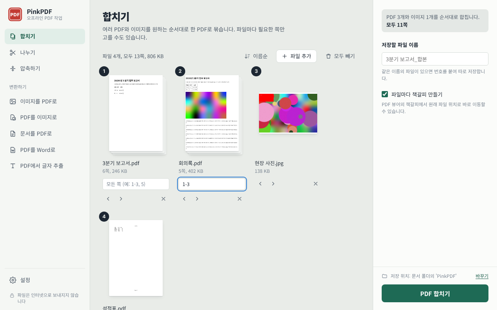
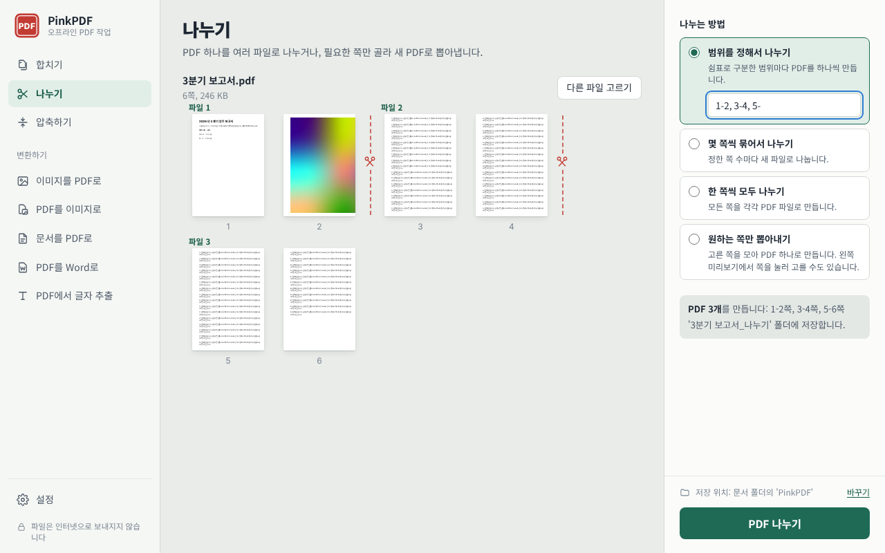
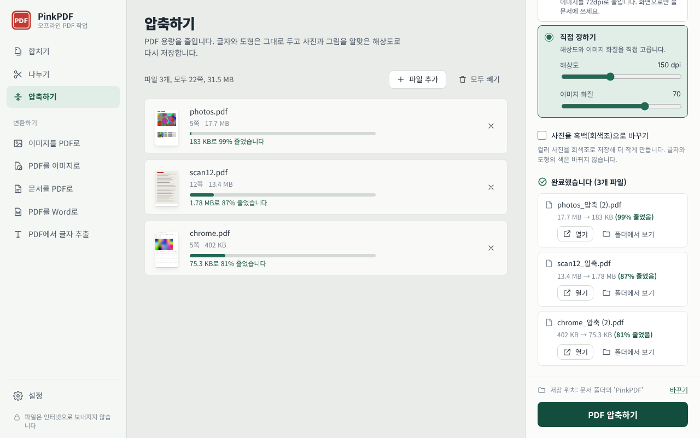

# PinkPDF

인터넷 연결 없이 내 PC 안에서 PDF를 **합치고, 나누고, 압축하고, 변환**하는 무료 Windows 프로그램입니다.
파일은 어디로도 전송되지 않습니다.



## 내려받기와 설치

[Releases](../../releases)에서 내려받습니다.

| 파일 | 설명 |
| --- | --- |
| `PinkPDF-Setup.exe` | 설치 파일 (권장). 관리자 권한 없이 설치되고, 시작 메뉴·바탕화면 바로가기와 [보내기] 메뉴를 만듭니다. |
| `PinkPDF.exe` | 설치 없이 바로 실행하는 단일 파일 |

- 처음 실행할 때 "Windows의 PC 보호" 창이 뜨면 **[추가 정보] → [실행]** 을 누르세요. 전자 서명이 없는 프로그램이라 나오는 안내입니다.
- 제거: Windows 설정 → 앱 → 설치된 앱 → **PinkPDF** → 제거
- 필요 환경: Windows 10/11 64비트, Microsoft Edge WebView2 런타임(Windows 11과 업데이트된 Windows 10에는 기본 포함, 없으면 기본 브라우저로 열림)

## 기능

**합치기** — 여러 PDF와 이미지를 원하는 순서로 하나로. 카드를 끌어 순서를 바꾸고, 파일마다 쪽 범위(`1-3, 5, 8-`)를 고르고, 파일별 책갈피를 만듭니다.

**나누기** — 범위별, N쪽씩, 한 쪽씩 나누기와 원하는 쪽만 뽑기. 모든 쪽을 미리 보여 주고, 어디서 잘리는지 가위 표시로 보여 줍니다.



**압축하기** — 글자와 도형은 그대로 두고 사진만 알맞은 해상도로 다시 저장합니다. 페이지에 실제로 그려지는 크기로 사진의 해상도를 계산하므로 필요 이상으로 화질을 깎지 않습니다. 가볍게(무손실) / 권장(150dpi) / 강하게(100dpi) / 최대로(72dpi) / 직접 정하기, 흑백 변환을 지원합니다.



**변환하기**
- 이미지 → PDF: JPG, PNG, GIF, BMP, TIFF, WEBP. JPG는 재압축 없이 넣어 화질이 그대로이고, 휴대폰 사진의 방향(EXIF)을 바로잡습니다.
- PDF → 이미지: PNG/JPG, 96·150·300dpi
- 문서 → PDF: Word, Excel, PowerPoint, 한글(hwp/hwpx). PC에 설치된 Microsoft Office, 한컴오피스 한글 또는 LibreOffice로 변환합니다.
- PDF → Word: Microsoft Word 2013 이상 또는 LibreOffice 필요
- PDF → 텍스트(.txt)

암호가 걸린 PDF도 암호를 입력하면 처리합니다. 결과는 원본 옆에 새 이름(`_합본`, `_압축` …)으로 저장하며 원본은 절대 덮어쓰지 않습니다.

자세한 사용법은 [docs/USER_GUIDE.txt](docs/USER_GUIDE.txt)에 있습니다.

## 직접 빌드하기

필요한 것은 [Go](https://go.dev/dl/) 1.25 이상뿐입니다. C 컴파일러가 필요 없고, 모든 라이브러리가 `vendor/`에 들어 있어 인터넷 없이 빌드됩니다.

| 환경 | 명령 | 결과 |
| --- | --- | --- |
| Windows | `build.bat` 더블클릭 | `dist\PinkPDF.exe`, `dist\PinkPDF-Setup.exe` |
| Linux / macOS | `sh build.sh` | 같은 Windows용 파일 두 개 |

GitHub에 올리면 Actions가 푸시할 때마다 두 파일을 빌드해 Artifacts로 올려 둡니다.
`v1.0.0` 같은 태그를 푸시하면 그 파일들로 Release를 자동으로 만듭니다.

```
git tag v1.0.0
git push origin v1.0.0
```

개발할 때는 `go run . -dev web` 으로 화면 파일을 디스크에서 읽어 브라우저로 열 수 있습니다.
테스트는 `go test ./...` 입니다. PowerShell 7(`pwsh`)이 설치되어 있으면 Office 변환·설치용 스크립트도 함께 검사합니다(GitHub Actions에는 기본으로 들어 있습니다).

## 구조

```
main.go app.go server.go     로컬 서버(127.0.0.1, 실행마다 바뀌는 포트·토큰), 파일 목록, 저장 위치
tasks.go jobs.go             작업(합치기, 나누기, 압축, 변환)과 진행률
window_windows.go            WebView2 앱 창 (실패하면 기본 브라우저로 대체)
platform_windows.go          파일 선택 창, 탐색기 열기
pdfops/                      PDF 엔진 (pdfcpu 기반): merge, split, compress, 이미지→PDF, 쪽 범위
convert/                     설치된 Office·한글·LibreOffice로 문서 변환
installer/  cmd/setup/       설치·제거 (사용자별 설치, 관리자 권한 불필요)
cmd/pack/                    빌드할 때 프로그램을 압축해 설치 파일에 넣는 도구
internal/winps/              숨김 PowerShell 실행 (Office 자동화, 바로가기)
web/                         화면 (HTML·CSS·JavaScript, PDF.js 6)
build/                       아이콘·버전 정보 원본 (go-winres)
docs/                        사용 설명서, 스크린샷
vendor/                      Go 라이브러리 사본 (인터넷 없이 빌드)
```

## 라이선스

MIT 라이선스입니다([LICENSE](LICENSE)). 함께 쓰인 오픈소스(pdfcpu, PDF.js, go-webview2, zenity 등)의 라이선스는 [THIRD_PARTY_LICENSES.txt](THIRD_PARTY_LICENSES.txt)에 있습니다.
